# Scopes Capture

Real-time color-grading scopes for macOS, captured from any display or window and GPU-accelerated with Metal.

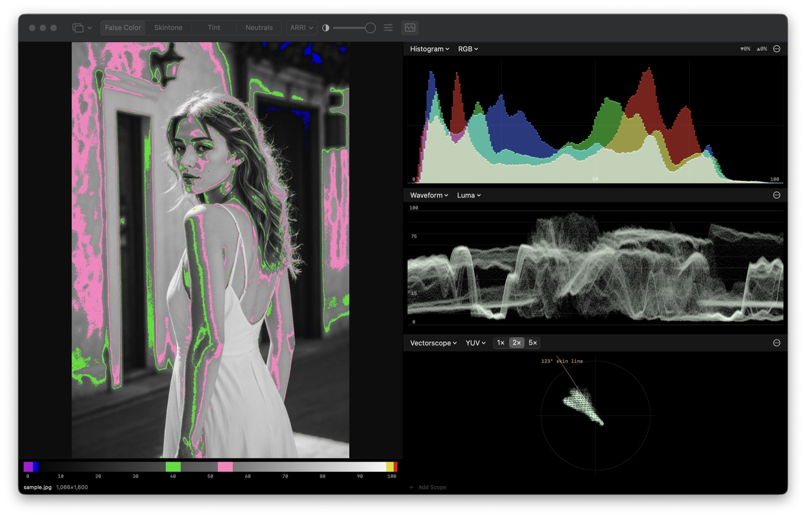

Picture scopes (drawn over the image):
- **False Color** — exposure: ARRI, RED Video, 5/10-band greyscale, Heatmap; retouching: Solar Curve, Contour Lines, Zone System, Print Clipping, Channel Clipping; custom presets as JSON (Load/Save).
- **Skintone** — highlights skin hues (YCbCr skin line or HSL), green on-line → red off-line.
- **Tint** — green ↔ magenta (CIE a*) per pixel, with GPU-measured average cast.
- **Neutrals** — near-neutral pixels colored blue ↔ yellow (CIE b*) for setting white balance.

Measurement scopes (scope column, press **S**; 1–3 panes, each with its own type and mode):
- **Waveform** — Luma, RGB overlay, RGB Parade, YRGB Parade; 10% graticule.
- **Vectorscope** — YUV with 75%/100% bar targets, skin line and 1×/2×/5× zoom; HSL polar mode.
- **Sat / Lum** — saturation against luma with a 95th-percentile curve.
- **Histogram** — RGB, Luma, Saturation, Hue; log scale; clipped-pixel readout.
- **Twin Peaks** — diamond display (B/G over R/G) with RGB gamut outline.

## Screenshots

All renders below use [`docs/sample.jpg`](docs/sample.jpg). Regenerate them with
`scripts/make-screenshots.sh`; the two app-window shots were taken from the app itself.

### Picture scopes

<table>
<tr>
<td width="33%">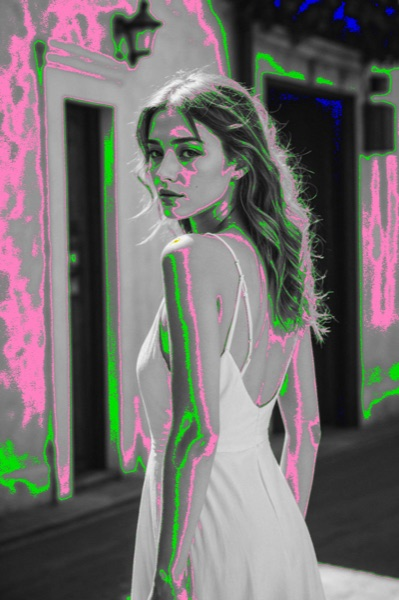 <b>False Color · ARRI</b> Clip, 18% gray and +1 stop zones over grayscale.</td>
<td width="33%">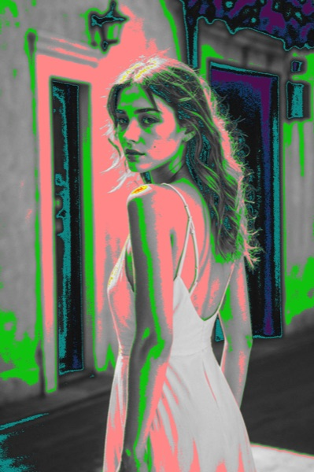 <b>False Color · RED Video</b> RED's video-mode bands; pink marks skin exposure.</td>
<td width="33%">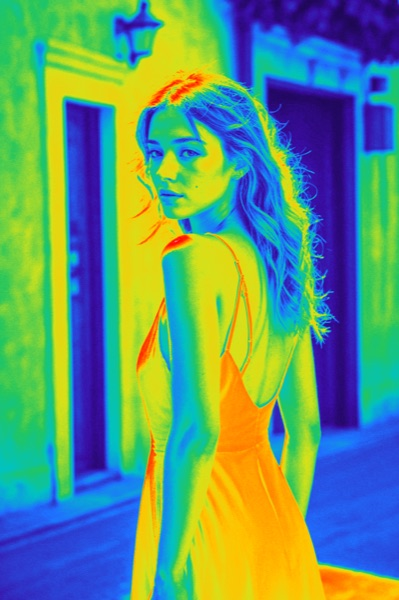 <b>False Color · Heatmap</b> Continuous violet → red scale.</td>
</tr>
<tr>
<td>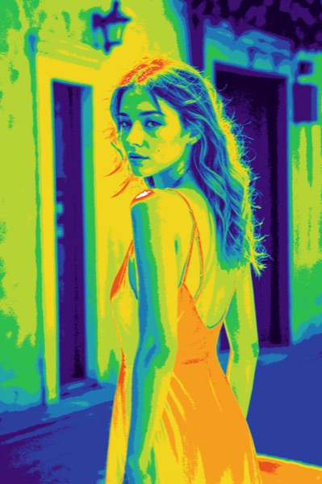 <b>Zone System</b> Adams' zones 0–X on L*, Zone V (middle grey) in green.</td>
<td>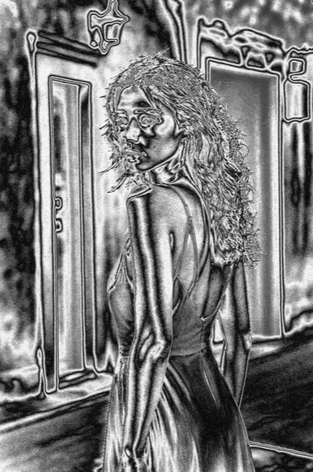 <b>Solar Curve</b> Retouching helper: tonal steps become hard edges.</td>
<td>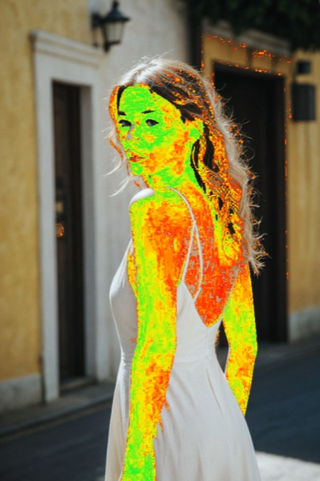 <b>Skintone</b> Skin hues: green on the skin line → red at the tolerance edge.</td>
</tr>
<tr>
<td>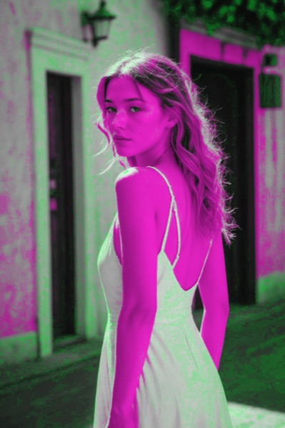 <b>Tint</b> Green ↔ magenta (a*) per pixel; skin redness shows magenta.</td>
<td>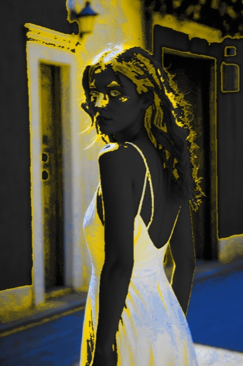 <b>Neutrals</b> Near-neutral pixels coloured blue ↔ yellow (b*) for white balance.</td>
<td>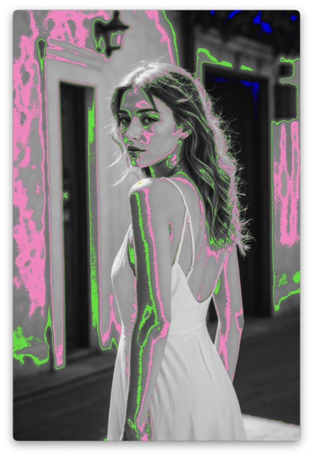 <b>Dock mode</b> Right-click: picture only, floating, locked to the picture's shape.</td>
</tr>
</table>

### Measurement scopes

<table>
<tr>
<td width="50%">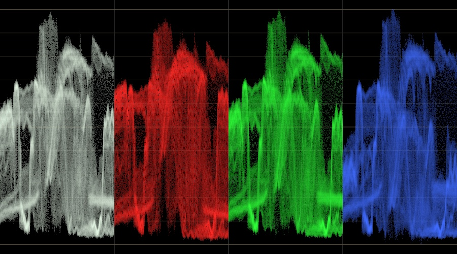 <b>Waveform · YRGB Parade</b></td>
<td width="50%">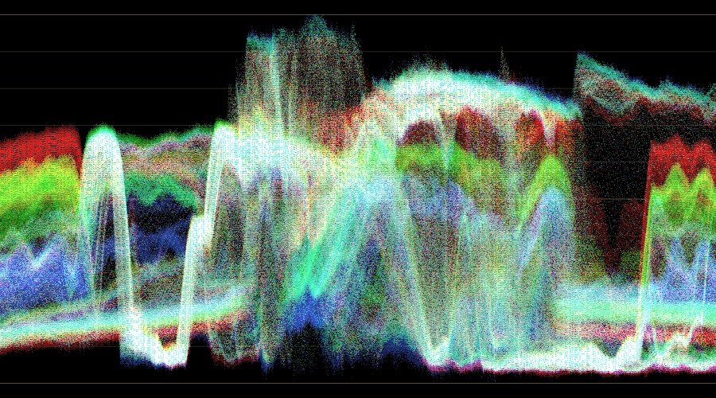 <b>Waveform · RGB overlay</b></td>
</tr>
<tr>
<td>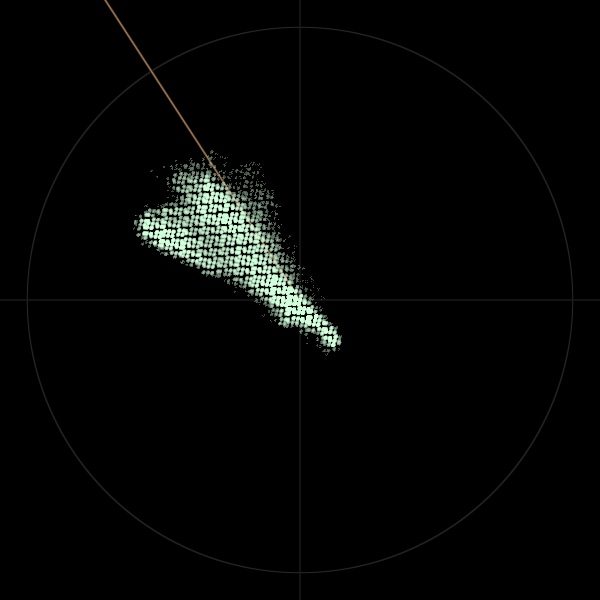 <b>Vectorscope · YUV (2×)</b> 75%/100% targets and the 123° skin line.</td>
<td>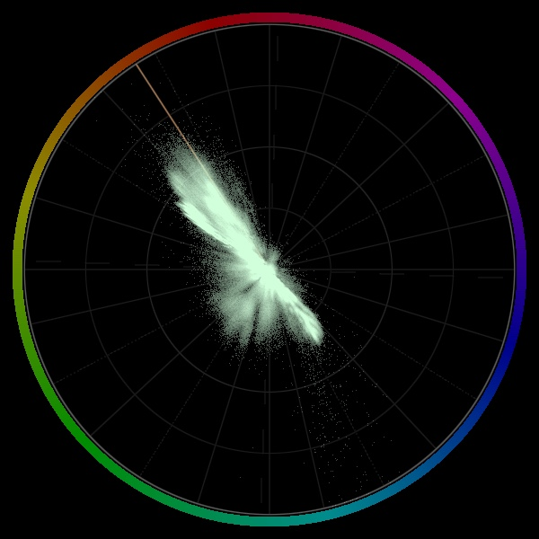 <b>Vectorscope · HSL</b></td>
</tr>
<tr>
<td>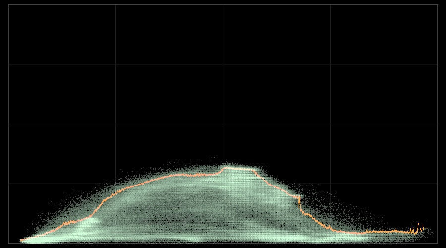 <b>Sat / Lum</b> Saturation against luma, with the 95th-percentile curve.</td>
<td>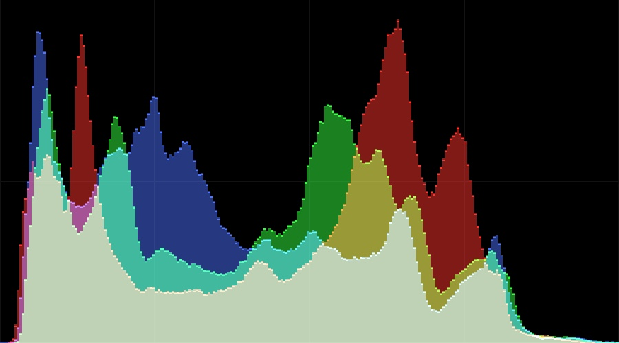 <b>Histogram · RGB</b></td>
</tr>
<tr>
<td>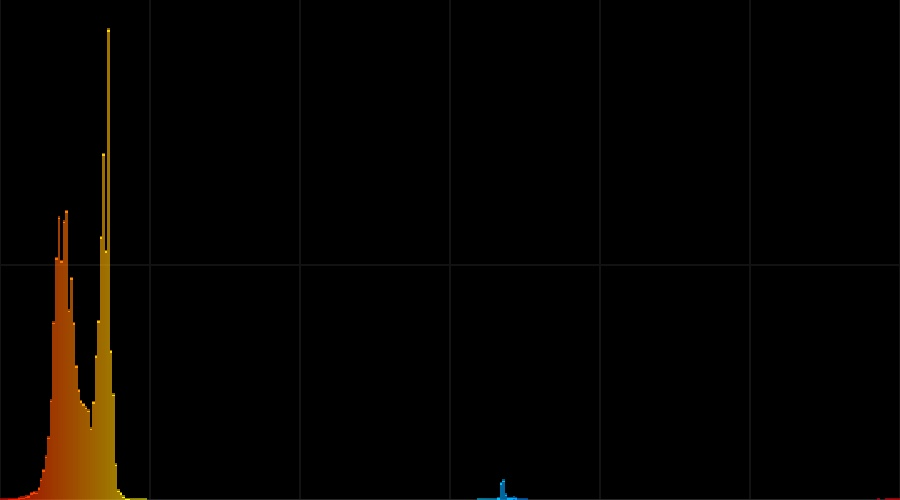 <b>Histogram · Hue</b></td>
<td>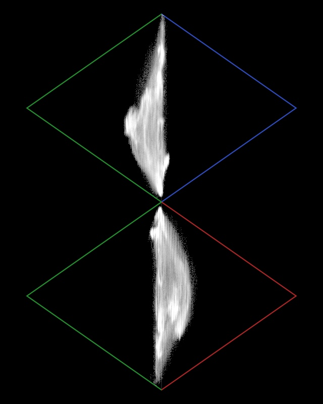 <b>Twin Peaks</b> B/G over R/G with the RGB gamut diamonds.</td>
</tr>
</table>

## Ergonomics

Scopes Capture is meant to sit next to your grading or retouching app all session, so it keeps
chrome, clicks and mouse travel to a minimum.

- **Dock mode.** Right-click the picture (or ⌃-click) to strip the window down to the picture alone:
  no title bar, toolbar, legend or status bar. Right-click again to get the full window back at
  its previous size.
  - **Stays on top** of other apps' windows, follows you to every Space, and is set up to sit over
    full-screen apps.
  - **No black bars.** The window locks to the picture's aspect ratio when you dock, when you resize,
    and when the source changes.
- **Drag the picture to move the window.** This works in both full and dock mode, so you don't need
  a title bar. The first click on an inactive window starts the drag straight away.
- **Keyboard first, no modifiers.**
  - `1`–`4` switch picture scopes, `↑`/`↓` step through false colour presets, `S` shows the scope
    column, `R` picks the capture region, and `Q` quits.
  - A short label confirms each change. That's the only place you see the name in dock mode,
    where there's no legend.
  - Keys are ignored while a dialog or the Options panel is open, and whenever ⌘, ⌃ or ⌥ is held,
    so system shortcuts keep working.
- **Shortcut guide.** Press `?` (⇧/) for an overlay listing every key and mouse action, including
  right-click and drag. Close it with `esc`, `?` or a click. It's also under **Help › Keyboard Shortcuts**.
- **Zoom without leaving the picture.**
  - The mouse wheel or a trackpad pinch zooms toward the pointer. Past 1:1, pixels show as crisp
    blocks, so you can read exactly which band each pixel falls in.
  - A two-finger scroll pans.
  - Double-click or `0` fits the whole picture, as does picking a new source.
- **Capture region on screen.** Press `R` to dim the display and draw, move or resize the
  region right where it is: `↩` applies, `F` selects the whole screen, `esc` cancels.
  - The change applies live, with no restart.
  - Each display remembers its own region across launches.
  - The app's own windows, including this overlay, are never captured.
- **Nothing to set up at launch.** The app starts capturing the main display straight away, and
  the source list updates itself as windows and apps come and go.
- **Scopes stay out of the way.** The scope column is hidden until you press `S`. Panes remember
  their layout, and `⇧1`–`⇧5` and `⇧↑`/`⇧↓` act on whichever pane you clicked last.

## Controls

| Key / action | Does |
| --- | --- |
| 1 / 2 / 3 / 4 | False Color / Skintone / Tint / Neutrals |
| ↑ / ↓ | Previous / next false color preset (False Color mode) |
| Drag the picture | Move the window (full and dock mode) |
| Mouse wheel / trackpad pinch / ⌘ + two-finger scroll | Zoom toward the pointer (pixels go crisp past 1:1) |
| Two-finger scroll | Pan when zoomed in |
| 0 or double-click | Fit the whole picture |
| R | Select the capture region on screen (↩ apply, F whole screen, esc cancel); remembered per display |
| Right-click (or ⌃-click) the picture | Toggle dock mode: picture only, floats above other windows, window keeps the picture's aspect ratio |
| S | Show / hide the scope column |
| ⇧1 – ⇧5 | Focused scope pane → Waveform / Vectorscope / Sat-Lum / Histogram / Twin Peaks |
| ⇧↑ / ⇧↓ | Previous / next mode of the focused scope pane |
| ? | Keyboard shortcut guide (also Help › Keyboard Shortcuts) |
| Q | Quit |

## Build & run

    scripts/build-app.sh            # release build → build/ScopesCapture.app
    open build/ScopesCapture.app

Requires macOS 14+. The first capture asks for Screen Recording permission
(System Settings › Privacy & Security › Screen & System Audio Recording); quit and
reopen the app after granting. The build script signs with your "Apple Development"
certificate when one is in the keychain (override with `CODESIGN_IDENTITY`), so the
permission survives rebuilds; without one it falls back to ad-hoc signing, which re-prompts.

**Releases.** Pushing a `v*` tag (`git tag v0.2.0 && git push origin v0.2.0`) runs
`.github/workflows/release.yml`, which builds a universal (Apple Silicon + Intel) app and attaches
`ScopesCapture-<version>.zip` to a GitHub Release. Release builds are ad-hoc signed unless the
Developer ID secrets listed in that workflow are set, in which case they're also notarized.

## Headless test

    .build/release/ScopesCapture --render <input.png|ramp|huesweep|wbchart|bars|l10r-bars> out.png <mode>
    # picture modes: a preset name ("RED Video", Heatmap, …), skin-ycbcr, skin-hsl, tint, neutrals
    #   (tint/neutrals also print the measured average a*/b*)
    # measurement modes: waveform-luma, waveform-rgb, parade-rgb, parade-yrgb, vector-yuv, vector-hsl,
    #   satlum, satlum-hsl, hist-rgb, hist-luma, hist-sat, hist-hue, twinpeaks
    # l10r-bars feeds colour bars through the 10-bit capture path
    .build/release/ScopesCapture --bench     # GPU time per measurement scope on a 4K source

## Pipeline

ScreenCaptureKit (10-bit `l10r` IOSurface, falling back to 8-bit BGRA) → CVMetalTextureCache
(zero-copy) → MTKViews that redraw only when a frame or setting changes.

- Picture scopes: one fragment shader (Rec.709 Y′ → 1024-entry LUT, Lab, skin hue).
- Measurement scopes: a once-per-frame **analysis pass** point-samples the frame (≤ ~1080p),
  dithers by one code value and writes R′G′B′Y′ + Cb Cr hue sat to half-float textures; each
  pane then **accumulates** samples into bins with GPU atomics (histograms count per
  threadgroup first) and a fragment shader tone-maps the bins and draws the graticule.
  About 0.4–1 ms of GPU time per pane on a 4K source (M3 Max, `--bench`).
